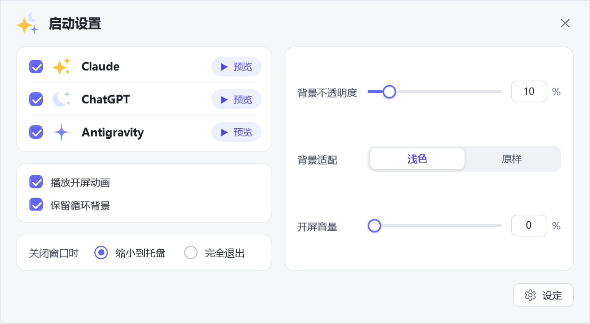

# Windows 合并版 · Claude / GPT / Gemini 三合一

把本仓库里 Windows 版的三个开机动画小程序（`claude/windows`、`codex/windows`、`antigravity/windows`）合并成一个程序：一个托盘图标、一个「启动设置」窗口、一个开机自启，同时管 Claude、ChatGPT（含 Codex）、Antigravity。和原版一样，它不修改这三个应用的任何文件，只在它们的窗口上盖一层浮层播放动画。播放逻辑（`Show` 类）沿用原版。

<p align="center">
  
  &nbsp;&nbsp;
  
</p>

> 非官方同人项目，与 Anthropic、OpenAI、Google 无关。Claude 是 Anthropic 的商标，ChatGPT、Codex 是 OpenAI 的商标，Gemini、Antigravity 是 Google 的商标。

## 安装（Windows 10 / 11）

在这个文件夹里打开 PowerShell，运行：

```powershell
powershell -ExecutionPolicy Bypass -File install.ps1
```

- **素材**：动画视频不重复放在这里。缺素材时，`install.ps1` 会从本仓库的 Releases（`v1.2.6` / `gpt-v1.2.5` / `gemini-v1.1.0`）下载三个 Windows 包，原样取出 `intro.mp4`、`loop.mp4`、`loop-x2.mp4`，一共约 150MB。`-OnlyAssets` 参数只下载素材。
- **已装原版**：如果装过原版的三个小程序，会先迁移它们的设置，再用它们自带的 `uninstall.ps1` 卸掉，免得同一个窗口上叠两层动画。
- **编译**：只用 Windows 自带的 .NET Framework 编译器和 `d3dcompiler_47.dll`，不需要安装任何 SDK。
- **安装位置**：程序就在这个文件夹里运行，并设为开机自启。

## 用法

- **托盘图标**：左键单击打开「启动设置」；右键只有「启动设置 / 退出」两项。
- **「启动设置」**：
  - 左栏：
    - 三个应用各带图标，打勾即启用；右边的「预览」会在该应用当前的窗口上播放一次开屏动画。
    - 播放开屏动画、保留循环背景两个开关。
    - 关闭窗口时缩小到托盘，还是完全退出。
  - 右栏：
    - 背景不透明度：拉杆或直接输入，预设 10%。
    - 背景适配：浅色 / 原样，见下一节。
    - 开屏音量：拉杆或直接输入，预设 0，也就是静音。
  - 右下角「设定」：收起正在播放的动画、打开设置文件夹、卸载。
  - 所有改动立刻生效。
- **跳过开屏**：开屏时在画面上任意位置点一下即可，代替右上角的「跳过」按钮。进入循环背景后浮层是点击穿透的。
- **什么时候播放**：只有应用真正新启动时才播。本程序启动时已经开着的应用，包括最小化、缩在托盘里的，都不会补播，之后最小化、还原也不会重播。

## 背景适配（只作用于循环背景）

三段动画的背景都是暗色星空。原版把整段画面半透明地盖上去：浅色界面会被压出一层灰，亮的人物在白底上反而看不见；深色界面会被提亮一层。

选「浅色」时，用像素着色器（`src/ContrastBackground.hlsl`）在运行时处理：

1. **去背景**：按亮度把星空抠成透明，只留人物和光效。阈值按每段动画星空的实际亮度分别设定（`Profile.KeyLo` / `KeyHi`）。
2. **调色**：在原色上加饱和、加对比，中间调稍微压深，白底上颜色立得住。

选「原样」就和原版完全一样。素材文件不做任何修改，开屏动画始终原样播放。

## 多块屏幕

原版调用 `SetProcessDPIAware`（系统 DPI）。目标窗口的位置取自 `DWMWA_EXTENDED_FRAME_BOUNDS`（物理像素），而 `SetWindowPos` 在缩放和主屏不同的屏幕上用的是虚拟化坐标，所以在那块屏上浮层会错位、大小不对。

这里的改法：

- 改成 Per-Monitor V2（`src/app.manifest`，加上 `src/app.config` 里的 `Switch.System.Windows.DoNotScaleForDpiChanges=false`）。
- 每一帧都核对浮层和目标窗口的位置。

在 125% 和 100% 两块屏之间拖动目标窗口实测，浮层和窗口的坐标完全一致。

## 文件

| 路径 | 内容 |
|---|---|
| `src/AIBootAnimations.cs` | 合并版源码；开头注释写了改动说明 |
| `src/SettingsView.xaml`、`src/TrayMenu.xaml` | 「启动设置」窗口、托盘右键菜单的界面 |
| `src/ContrastBackground.hlsl` / `.ps` | 背景适配的着色器源码 / 编译结果 |
| `src/app.manifest`、`src/app.config` | 按屏幕 DPI 工作的清单 / 运行配置 |
| `src/app.ico` | 程序图标（`--render-ico` 生成） |
| `assets/<应用>/` | 各自的 `LICENSE.md`、`CREDITS.md`（复制自本仓库）；动画视频由 `install.ps1` 下载到这里 |
| `assets/fonts/` | 字幕字体 Libre Bodoni（SIL OFL） |
| `build.ps1` / `install.ps1` / `uninstall.ps1` | 编译 / 安装 / 卸载 |

- 设置：`%APPDATA%\AIBootAnimations\settings.json`，三个应用共用一份；`apps` 下是每个应用自己的开关和动画参数，字段和原版 `config.json` 一样。
- 日志：`%LOCALAPPDATA%\AIBootAnimations\log.txt`，每条前面带应用名。

## 授权

- 代码：沿用本仓库的 GPL-3.0，保留原作者署名，并在源码开头写明修改说明。
- 动画素材：CC BY-NC-ND 4.0，见各 `assets/<应用>/LICENSE.md`。素材文件一个字节都没改。
